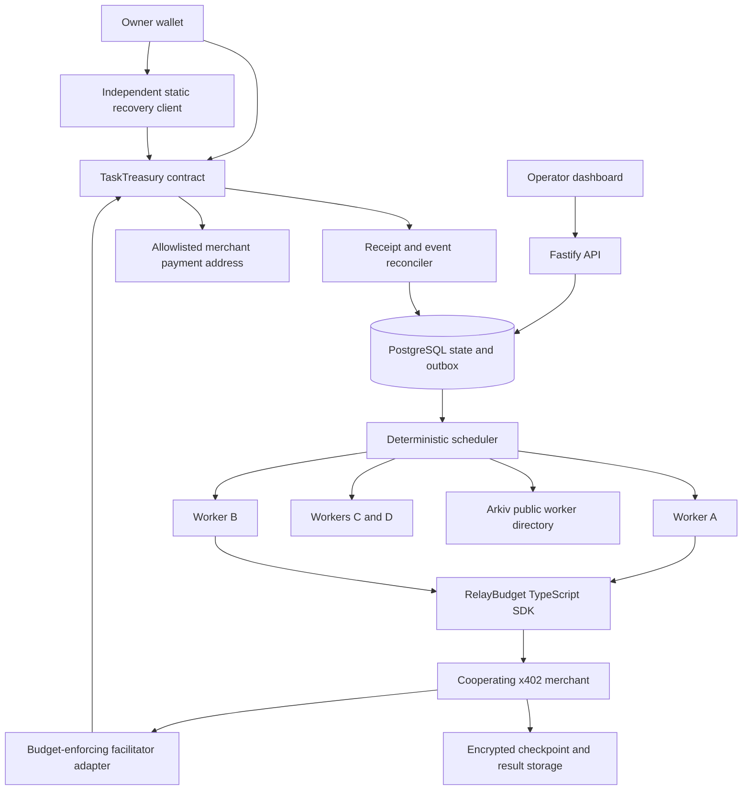

# Technical architecture and implementation stack

This is an implementation design, not a description of deployed software. All package versions and network identifiers must be pinned and recorded during Phase 0. API names marked proposed are ours, not promises about a third-party SDK.

## 1. Architecture



The scheduler chooses who attempts work. The contract decides what money can be committed and spent. A database lease improves scheduling but is not the financial enforcement boundary.

## 2. Authority model

Owner: deposits, creates task budgets/policies, replaces scheduler, freezes/cancels tasks, withdraws available funds. A multisig owner is a later deployment configuration; start with a test owner wallet.

Scheduler: assigns capable workers within existing budgets and policy. Cannot withdraw owner funds, increase a budget, change allowed merchants, or grant arbitrary token approvals. A malicious scheduler can still select a colluding worker that wastes the allowed budget on approved services; caps do not prove economic utility.

Worker: creates signed reservation requests for its active task epoch. It has no root treasury key and no generic `transfer` or `approve` capability over vault funds.

Merchant/facilitator: may settle an already authorized reservation until its deadline. Cannot create a new reservation without a valid current worker authorization or alter its amount/recipient. The facilitator may pay gas, but its private database is not the source of truth for financial limits.

Recovery client: talks directly to the contract using the owner's wallet and an RPC endpoint the user can replace. It must not fetch permission from our server.

## 3. Recommended stack

| Layer | Selection | Rationale / boundary |
|---|---|---|
| Language | TypeScript, Solidity | One application/SDK language and explicit financial contract |
| Runtime/package management | Supported Node LTS; pnpm workspace | Pin exact versions and lockfile, no floating `latest` in reproducible runs |
| Chain client | `viem`; optional `wagmi` for UI | ABI-typed contract interaction; verify chain transport in Phase 0 |
| Contracts | Foundry + OpenZeppelin Contracts | Build, fuzz/invariant tests, SafeERC20, signature helpers, reentrancy guard [D5-D7] |
| Preferred live execution | Hedera testnet, supported HTS test asset | Only after token association, ERC20 redirect, signatures, fee payer, and explorer evidence pass |
| Local execution | Anvil + fixed-decimal mock token | Deterministic tests; never present it as live sponsor settlement |
| API | Fastify + schema validation (`zod` or equivalent) | Small typed HTTP surface [D9] |
| Storage | PostgreSQL + `pg` + SQL migrations | Transactions, uniqueness constraints, outbox; no Redis dependency for correctness [D10-D11] |
| Workflow | Thin task runner first; LangGraph adapter | Reuse persistence/checkpoint facilities, avoid a new general agent framework [D1] |
| Payments | Current x402 packages; prefer Hedera `exact` with `transferExecutor` | Verify facilitator support; identifiers and receipts are baseline capabilities [D2, D4, D12] |
| Discovery | `@arkiv-network/sdk` | Real expiring worker entities and client-visible queries [S3, D13] |
| UI | React + Vite | One treasury/task screen and a separately built static recovery screen |
| Tests | Vitest, Foundry, Playwright | Model/unit/integration, contract properties, actual browser journey |
| Telemetry | OpenTelemetry + local collector | Redacted traces and reproducible timings; no third-party browser trackers [D14] |
| Security tools | Slither; optional Echidna after Foundry invariants | Findings need reproduction and triage, not an "audited" badge [D15-D16] |

Library names are stack selections. The phase-0 lockfile is the version source of truth. Do not write code against an assumed latest API; consult primary docs for the installed release.

## 4. Payment compatibility: the critical integration spike

Ordinary wallet authorizations can move funds outside our contract; an offchain budget display does not constrain them. The current Hedera `exact` specification defines `transferExecutor` for contract-controlled funds, in addition to the default `cryptoTransfer` method [D17]. Prefer that existing route. Specification support does not establish that a particular facilitator implements it.

Proposed integration: TaskTreasury implements the executor interface in the contract specification. Its opaque authorization identifies an existing reservation. The contract validates the fixed payment and consumes that reservation through the same internal settlement routine. The reference merchant serves results after confirmed payment and preserves them for retries.

Pin the source commit and packages. Query the chosen facilitator's supported methods and executor admission before advertising the route. If unavailable, implement a self-run compatible facilitator or, only as an explicit fallback, an experimental `relaybudget-v1` scheme. Confirm that fallback with sponsor staff; do not silently label it standard `exact` support.

Phase 0 must demonstrate the full path on Hedera, including supported HTS token movement and a HashScan transaction. Test association, address resolution, issuer settings, and the correct contract-held-token transfer mechanism. Verify consensus effects including child records; simulation alone is not payment. Do not substitute an agent wallet whose authority bypasses the vault.

Fallback: prove core correctness locally or on a conventional EVM testnet and omit the Hedera claim. A deadline-driven core-only release is better than disconnected sponsor transfers. Arc is an alternative only if the project genuinely starts in Arc Studio and satisfies its requirements; it is not a late badge [S5].

## 5. Backend setup

Processes: `api`, `scheduler`, `reconciler`, four worker processes, reference merchant, custom facilitator. Use a single repository and local Docker Compose for PostgreSQL and optional telemetry collector. Native Foundry/Slither may be easiest in WSL2 or a pinned Linux container on Windows. Document one supported path, not several half-tested setups.

Database tables (minimum):

| Table | Important fields / uniqueness |
|---|---|
| treasuries | chain_id, contract_address, owner, ABI version; unique chain+address |
| tasks | task_id, treasury, chain epoch/status projection, capability set, checkpoint revision |
| assignments | task_id, epoch, worker_address, lease_until; unique task+epoch |
| operations | op_key, task_id, step_id, request_hash, provider, amount, state; unique scoped op_key |
| reservations | chain reservation_id, op_key, attempt, expiry, tx/block refs; unique reservation_id |
| merchant_results | op_key, request_hash, ciphertext_ref, digest, delivery status; unique tenant+merchant+op_key |
| checkpoints | task_id, revision, encrypted_blob_ref, ciphertext_hash, producer epoch |
| chain_events | chain, block_hash, tx_hash, log_index, removed/final flags; unique event identity |
| outbox | message_id, type, payload, status, attempt count; unique business action key |
| fault_events | run_id, task, fault type, injected/observed time, seed |

Use integer base units (`bigint`/numeric strings); never JavaScript floating-point dollars. Database transactions use the same checked-out `pg` connection [D10]. Use row locking/CAS for scheduler assignment and an outbox for reliable messages. External calls occur outside long-held DB locks. The contract remains authoritative when a projection disagrees.

MVP registry data: worker public key, capability codes, endpoint identifier, supported scheme/network, operator signature, sequence, expiry. No budgets, prompts, customer identifiers, raw errors, or private checkpoint references in public entities. Scheduler verifies signatures and freshness and performs an authenticated readiness check. An Arkiv record alone is not authority to spend or proof of capability. TTL is an availability/freshness feature, not a confidentiality guarantee or proof of historical erasure [D13].

## 6. Proposed API and SDK

The following is our proposed surface, not existing package syntax:

```ts
interface RelayBudget {
  createTask(input: TaskPolicy): Promise<TaskHandle>;
  assign(taskId: string, worker: WorkerRef): Promise<AssignmentReceipt>;
  executePaidStep(input: {
    taskId: string;
    stepId: string; // stable across worker replacement
    request: CanonicalRequest;
    maxAmount: bigint;
  }): Promise<PaidStepResult>;
  reconcile(opKey: string): Promise<FinancialOperationState>;
  checkpoint(taskId: string, state: VersionedCheckpoint): Promise<CheckpointRef>;
  handoff(taskId: string, candidate: WorkerRef): Promise<HandoffReceipt>;
  cancelAndRecover(taskId: string): Promise<RecoveryReceipt>;
}
```

HTTP proposals: `POST /tasks`, `POST /tasks/:id/assign`, `GET /tasks/:id`, `POST /tasks/:id/checkpoints`, `POST /operations/:key/reconcile`, `GET /operations/:key/result`, `GET /events` (SSE), and dev-only authenticated `POST /demo/faults`. Signed owner/scheduler requests use nonce, expiry, domain, and tenant scope; do not accept identity based only on a client-supplied wallet address.

Checkpoint schema: version, workflow definition hash, task ID, producer epoch, completed step IDs, purchased artifact references, outstanding op keys, tool/model configuration identifiers, validation status, and next step. Serialize deterministically and encrypt. Reject incompatible workflow versions or stale checkpoints rather than silently resuming arbitrary code.

## 7. Handoff protocol

1. Observe a failure: timeout, heartbeat loss, 429, explicit provider error, or process exit. A timeout is suspicion, not proof of non-payment.
2. Inspect durable operation records and reconcile affected chain reservations. Record `UNKNOWN` when evidence is insufficient.
3. Choose a worker with matching capabilities and legitimate provider access. Respect backoff and account-wide rate limits; wait if replacement cannot help.
4. Owner-authorized scheduler calls `assignTask(taskId, newExecutor, newLeaseUntil)`; contract increments epoch. Reserve creation in the old epoch is fenced immediately in canonical chain order.
5. Wait for selected chain's receipt/finality policy. Do not call a transaction hash final settlement.
6. Restore the last validated checkpoint. Transfer only the necessary encrypted material to the replacement. Backend key access is an explicit trust assumption.
7. Resume unfinished logical steps. Settled operations fetch results. Reserved/unknown operations reconcile or wait. Never create a new charge merely because the old HTTP request timed out.
8. Other tasks continue. A shared provider-wide outage may still affect them; report it honestly rather than asserting total isolation.

The chain arbitrates races: if A reserves just before assignment, the commitment is valid and remains reserved. If its reserve lands after assignment, it fails. The system does not promise retroactive revocation.

## 8. Merchant durability protocol

`opKey` is stable across worker changes and scoped to treasury/task/step; the request fingerprint also binds provider, route, price, token, chain, and canonical body hash. It must not include the current assignment epoch, because that would create a new purchase identity on handoff.

Merchant persists `intent -> settlement_pending -> paid -> producing -> result_ready`. Concurrent retries serialize on its unique op key. A new request with an existing key but changed fingerprint gets a conflict. If a payment is already settled and a result is ready, authenticate current task authority and return the same result. A new worker must not lose retrieval access because the original worker key changed.

No universal exactly-once output generation is claimed: the paid upstream API may itself be non-idempotent. For the reference merchant, use immutable fixture artifacts and durable result writes. For external providers, integrate their own operation IDs and status APIs. Missing merchant records or an expired cache cause reconciliation/manual review, not automatic recharging. This is deliberately stricter than treating a volatile cache as the full payment ledger [D2].

## 9. Keys and privacy

Owner key: wallet only. Worker key: per-worker test credential with task-scoped authority, never root owner. Scheduler key: restricted assignment role. Facilitator gas key: no treasury withdrawal right. Merchant quote key: allowlisted verification identity. Separate these roles in configuration and tests.

Encrypt payloads using a vetted envelope-encryption library or WebCrypto AES-GCM with unique nonces and explicit key-wrapping identities. Store ciphertext hashes, not low-entropy plaintext hashes. The orchestrator or authorized workers may decrypt task material; this is not a server-blind design. Provider sees the request it processes. Public chain sees task/payment metadata and amounts. No tracker scripts or third-party client analytics.

Avoid storing recoverability-critical material exclusively in expiring public infrastructure. Owner export includes contract identity and ABI plus encrypted checkpoints. Owner financial exit needs only contract state, owner key, RPC, gas, and token operability; task continuation also needs available checkpoint/result data.

## 10. Recovery and deployment

Recovery app is a separate static build with locally vendored ABI and checksums, configurable RPC, chain-ID check, and explicit contract address verification. It reads authoritative state and submits `cancelTask`, reservation expiry, and `withdrawUnallocated` directly. No server login or hosted API token is required. If the primary domain is unavailable, run the exported build locally.

Deployment manifest records chain ID, token address/ID/decimals, contract address and runtime hash, compiler, source commit, constructor args, owner/scheduler identities, max reservation TTL, explorer URLs, and finality policy. Verify deployed code. Never deploy mainnet from documentation prompts. Testnet transactions and live credentials are a separate implementation step.
